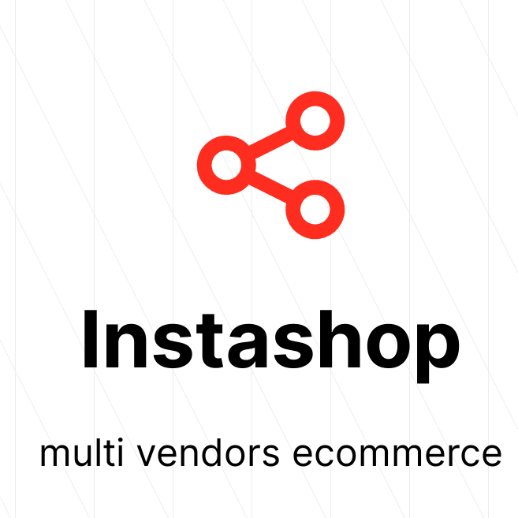
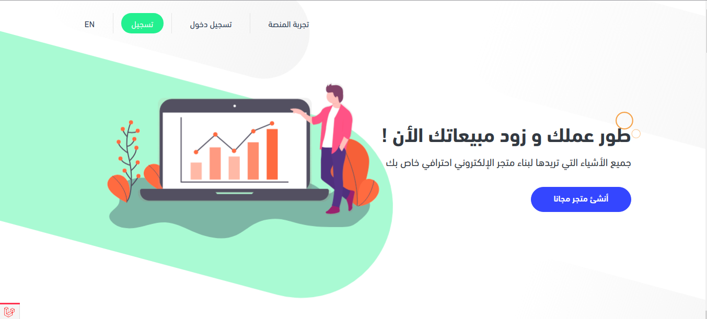
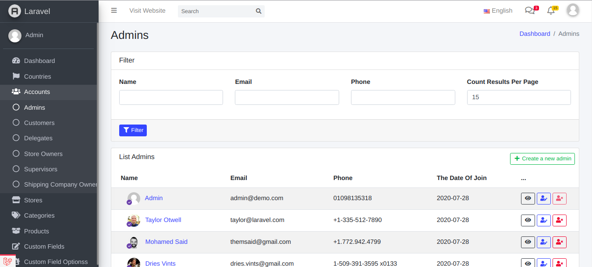
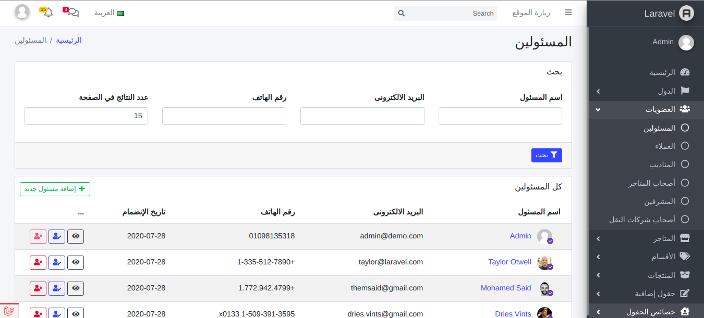
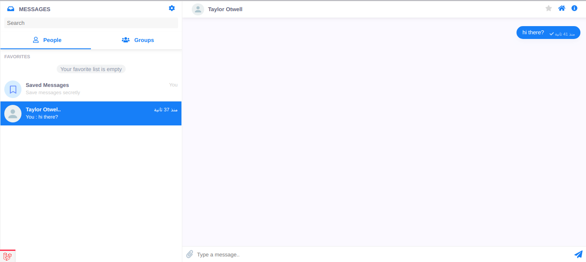
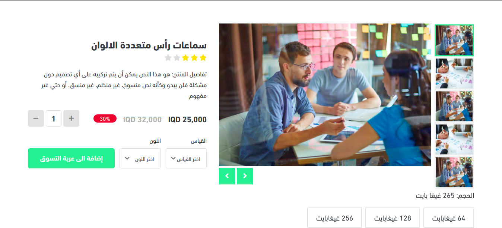
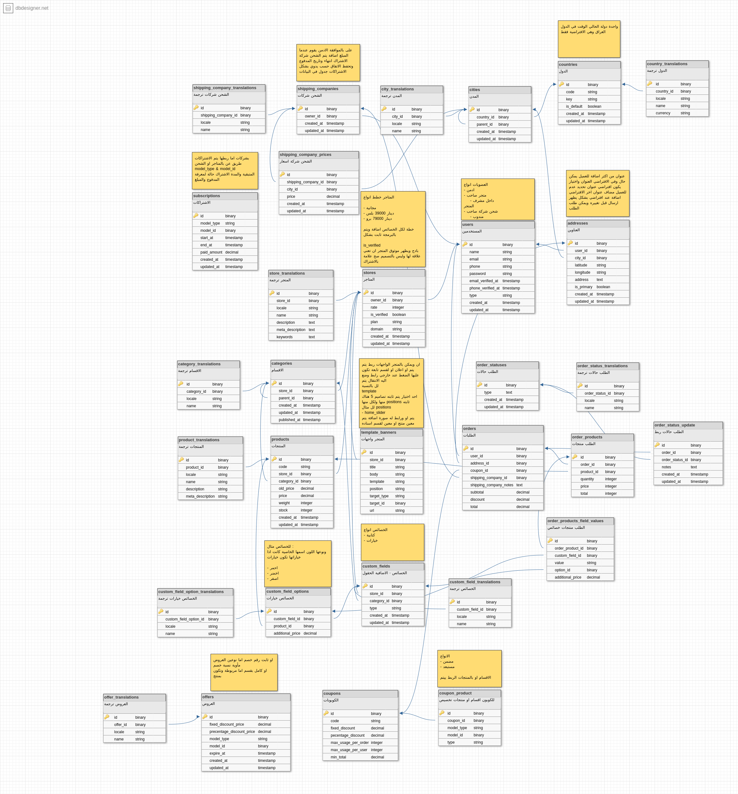

# Instashop — Multi-Vendor E-Commerce Platform

A full-featured multi-vendor marketplace built with Laravel, featuring vendor storefronts, real-time chat, role-based access, and a bilingual (AR/EN) admin dashboard.

> 72 stars · 30 forks



---

## Features

- **Multi-vendor architecture** — vendors register, manage their own store and inventory via a dedicated dashboard
- **Role-based access control** — Admin, Supervisor, Store Owner, Shipping Company, Customer
- **Bilingual support** — full Arabic/English UI with RTL layout
- **Real-time chat** — vendor-customer messaging
- **Payment & shipping integration** — pluggable gateway support
- **REST API** — Laravel Passport authentication with Repository pattern
- **Media management** — Spatie MediaLibrary for product images
- **PHPUnit test suite**

---

## Architecture & Patterns

- Repository Pattern for data access abstraction
- Laravel Modules for domain separation
- Resource Policies & Form Requests for authorization and validation
- Query Filters for flexible API querying
- AdminLTE 3 + Vue.js frontend

---

## Screenshots

| Home | Vendor Dashboard (EN) |
|------|-----------------------|
|  |  |

| Vendor Dashboard (AR) | Real-time Chat |
|-----------------------|----------------|
|  |  |

| Product Page |
|--------------|
|  |

---

## Database Design



---

## Tech Stack

| Layer | Technology |
|-------|-----------|
| Backend | PHP 7.2+, Laravel 7 |
| Frontend | Vue.js, AdminLTE 3, jQuery |
| Database | MySQL |
| Auth | Laravel Passport (OAuth2) |
| Media | Spatie MediaLibrary |
| i18n | laravel-vue-i18n-generator |
| Testing | PHPUnit |

---

## Quick Start

```bash
composer install
npm install
cp .env.example .env
php artisan key:generate
php artisan migrate --seed
php artisan serve
```

Visit `http://127.0.0.1:8000`

---

## Demo Credentials

| Role | Email | Password |
|------|-------|----------|
| Admin | admin@demo.com | password |
| Customer | jeffrey@laracasts.com | password |
| Store Owner | alice@toptal.org | password |
| Shipping Company | fedex@shipping.org | password |
| Supervisor | andre@madarang.org | password |
